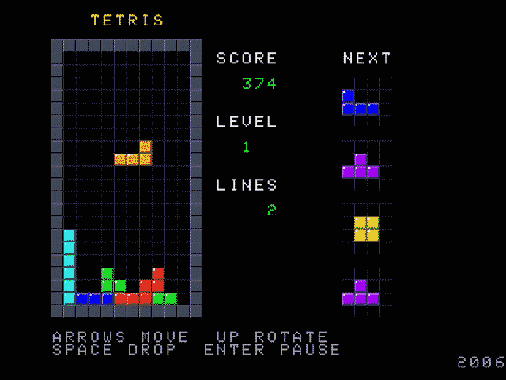

# TETRIS for the Zeal 8-bit Computer

A complete Tetris implementation for the [Zeal 8-bit Computer](https://zeal8bit.com)
running [Zeal 8-bit OS](https://github.com/Zeal8bit/Zeal-8-bit-OS).

It is written in C for SDCC and talks to the hardware through the official
[Zeal VideoBoard SDK](https://github.com/Zeal8bit/Zeal-VideoBoard-SDK) and the
[Zeal Game Dev Kit](https://github.com/zoul0813/zeal-game-dev-kit). The game
runs on real hardware and in the `zeal-native` emulator.

Current release: **RC2**.



## Features

- All seven tetrominoes with four rotations each and SRS-style wall kicks
  (the I piece uses its own kick table).
- 7-bag randomizer and a four-piece next queue.
- Soft drop, hard drop, DAS/auto-repeat and a lock delay with move resets.
- 20 speed levels: one level every 10 lines, classic gravity curve.
- Classic scoring: 40 / 100 / 300 / 1200 points per single / double / triple /
  tetris, multiplied by `level + 1`; hard drop awards 2 points per row.
- Pause / resume, restart and "quit to OS" menus, plus a game-over overlay.
- Sound effects on the VideoBoard's sound chip:
  - a short beep on every downward step, rising in pitch as the piece
    approaches the bottom of the board;
  - a noise burst with a low thump when one or more lines are cleared.
- Keyboard and SNES-style gamepad input.
- Native 640×480 4bpp mode: 40×30 tile grid of 16×16 tiles, with only four
  procedurally generated tiles plus a 5×7 font expanded into 16×16 glyphs at
  startup.

## Controls

| Action                       | Keyboard        | Gamepad            |
| ---------------------------- | --------------- | ------------------ |
| Move left / right            | Left / Right    | D-pad left / right |
| Soft drop                    | Down            | D-pad down         |
| Rotate clockwise             | Up or X         | Up, A, X or Y      |
| Hard drop                    | Space           | B                  |
| Pause / resume               | Enter           | Start              |
| Restart (paused / game over) | W               | R                  |
| Quit to OS (paused / game over) | Q            | L                  |

Horizontal movement uses a 267 ms delay before auto-repeat, then repeats every
100 ms. A grounded piece locks after 0.5 s, and moving or rotating it resets
that timer up to 15 times.

## Building

### Requirements

- [SDCC](https://sdcc.sourceforge.net/) 4.4.0 (4.2.0 or newer should work)
- Zeal 8-bit OS sources (for the C runtime and `base_sdcc.mk`)
- Zeal VideoBoard SDK (graphics and sound library)
- Zeal Game Dev Kit (tilemap, input and sound helpers)

All four must be available as source/library trees on the build machine.

### Build

```sh
make
```

The resulting binary is `bin/tetris.bin`.

The Makefile assumes the same layout used during development. Override any of
the paths on the command line or through the environment:

| Variable       | Default                                    |
| -------------- | ------------------------------------------ |
| `SDCC_BIN`     | `~/work/tools/sdcc-4.4.0/bin`              |
| `ZOS_PATH`     | `~/work/sdk/Zeal-8-bit-OS`                 |
| `ZVB_SDK_PATH` | `~/work/sdk/Zeal-VideoBoard-SDK`           |
| `ZGDK_PATH`    | `~/work/sdk/zeal-game-dev-kit`             |
| `ZEAL_NATIVE`  | `~/work/zeal-native-linux-x64/zeal-native` |
| `OS_IMAGE`     | `~/work/zeal-native-linux-x64/zos/os_with_romdisk.img` |

For example:

```sh
make ZOS_PATH=$HOME/sdk/Zeal-8-bit-OS ZVB_SDK_PATH=$HOME/sdk/Zeal-VideoBoard-SDK \
     ZGDK_PATH=$HOME/sdk/zeal-game-dev-kit
```

### Run in the emulator

```sh
make run
```

This boots `zeal-native` with a Zeal 8-bit OS image and loads `bin/tetris.bin`
as the user program.

### Run on real hardware

Copy `bin/tetris.bin` to the SD card or romdisk image used by Zeal 8-bit OS,
boot the machine and start the program from the OS shell.

Build output under `bin/` is not tracked by Git. Prebuilt binaries are
published on the [Releases](../../releases) page, so a build toolchain is only
needed when changing the source.

## Implementation notes

The game is a single translation unit, `src/main.c`, with no dynamic memory
allocation and no file I/O.

- **Video.** The VideoBoard runs in `GFX_640_4BIT`. Layer 0 holds the tile
  indices, layer 1 holds the attributes: the high nibble selects one of 14
  palette groups, which is how a single beveled block tile is recoloured for
  each tetromino. The whole interface is built from four tiles (empty cell,
  grid cell, block, border) and the font tiles.
- **Rendering.** Only the board is redrawn every frame, and only when it
  changed. Overlays (pause, game over) are drawn on top of the scene and the
  scene is fully rebuilt when they are dismissed, because the tilemap has no
  backing buffer.
- **Timing.** The main loop is synchronised to the vertical blank. All delays
  (DAS, soft drop rate, lock delay, gravity) are counted in frames; gravity is
  kept in 1/256 rows per frame.
- **Sound.** Effects use the Game Dev Kit sound API, whose durations are also
  measured in frames: `sound_loop()` is called once per frame to expire active
  tones. Voice 0 plays the drop beep (240 Hz + 40 Hz per row), voices 1 and 2
  play the line-clear noise burst and thump.
- **Size.** The linked program is roughly 9.6 KB of code with under 700 bytes
  of data and BSS, leaving plenty of room on a stock machine.

## Project layout

```
Makefile          build rules and default SDK paths
src/main.c        the whole game
bin/              build output (ignored by Git)
docs/             screenshot used in this README
AGENTS.md         development guidelines for AI-assisted work
```

## Acknowledgements

- The 5×7 glyph set is the public-domain Adafruit GFX font.
- Thanks to the Zeal8bit project for the OS, the VideoBoard SDK and the
  emulator, and to zoul0813 for the Zeal Game Dev Kit.
- The game logic is a C port of an earlier Go/Fyne implementation of the same
  game.

## License

Released under the MIT License. See [LICENSE](LICENSE).

Copyright (c) 2026 ed.
